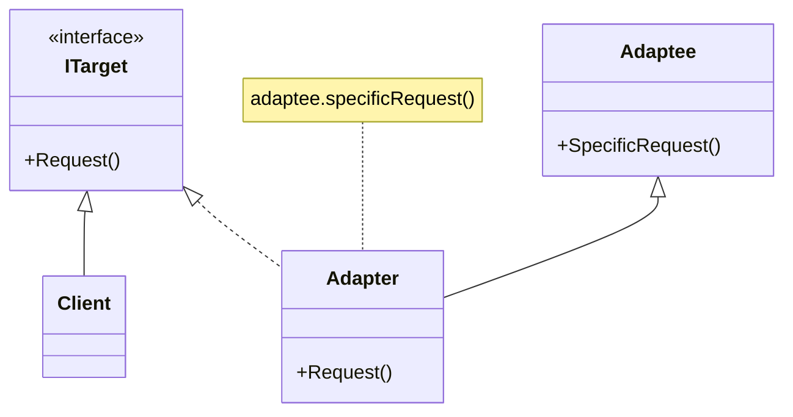

# Adapter

## Définition

Le patron de conception **adaptateur** (adapter) autorise l'interface (API) d'une classe existante, à être réutilisée par une autre classe pour fournir une autre interface.

Il est souvent utilisé pour rendre des classes existantes compatibles entre elles sans modifier leurs codes.

## Diagramme



## Exemple

Une entreprise possède différentes machines où sont enregistré des fichiers de reportings, chacune d'elle dispose de protocoles différents pour les télécharger.

A partir d'un client *HTTP* et d'un client *FTP* ayant chacun leur propre structure d'API, nous allons mettre en place une **API commune** pour ces deux types de clients :

```csharp
/// <summary>
/// HTTP client adaptee
/// </summary>
public class HttpClient
{
    public void Get(string sourcePath, string destinationPath)
    {
        // Logic to get a file
    }
}
  
/// <summary>
/// FTP client adaptee
/// </summary>
public class FtpClient
{
    public void DownloadFile(string sourcePath, string destinationPath, bool removeOnRemote)
    {
        // Logic to get a file
    }
}
  
/// <summary>
/// Target
/// </summary>
public interface IClient
{
    void Download(string sourcePath, string destinationPath);
}
  
/// <summary>
/// HTTP Client Adapter
/// </summary>
public class HttpClientAdapter : IClient
{
    private HttpClient _client { get; set; }
  
    public HttpClientAdapter()
    {
        _client = new HttpClient();
    }
  
    public void Download(string sourcePath, string destinationPath)
    {
        _client.Get(sourcePath, destinationPath);
    }
}
  
/// <summary>
/// FTP Client Adapter
/// </summary>
public class FtpClientAdapter : IClient
{
    private FtpClient _client { get; set; }
  
    public FtpClientAdapter()
    {
        _client = new FtpClient();
    }
  
    public void Download(string sourcePath, string destinationPath)
    {
        _client.DownloadFile(sourcePath, destinationPath, false);
    }
}
```

Nous pouvons ensuite l'utiliser de la façon suivante, sans nous soucier des spécificités de chaque clients et de la gestion de leurs comportements respectifs.

```csharp
...
foreach(Server server in servers)
{
    IClient client;
    switch(server.type)
    {
        case Protocol.Ftp:
            client = new HttpClientAdapter();
            break;
        case Protocol.Http:
            client = new FtpClientAdapter();
            break;
        default:
            throw new NotImplementedException();
    }
    client.Download("/reporting/202006.xls", Path.Combine(Directory.GetCurrentDirectory(), server.Name));
}
...
```
