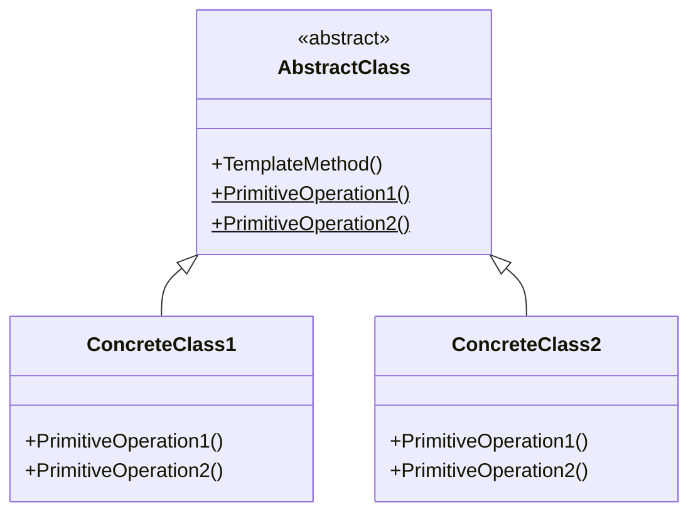

# Template method

## Définition
Ce patron de conception permet de définir les *étapes d'exécution* d'un algorithme.

Certaines de ces étapes pouvant être implémentées dans des sous-classes pour permettre des comportements différents tout en garantissant le même ordre d'exécution.



## Exemple

Une société dispose de deux établissements : un *casino* et un *restaurant*.
La création d'un nouveau compte sur l'un ou l'autre se matérialise par une **succession d'étapes** :
1. Vérification des informations
2. Enregistrement en base de données
3. Envoi d'un courriel de bienvenue

Ces étapes doivent donc **être exécuté dans le même ordre** quel que soit l'établissement, cependant chacun à sa façon de les implémenter.

Pour réaliser cette fonctionnalité, nous avons besoin de :
* Une classe ```CustomerRegister``` qui déclare les méthodes pour chacune des étapes ainsi qu’une méthode qui va les utiliser.
* Une classe ```CasinoCustomerRegister``` qui implémente les différentes étapes dans le contexte d’une inscription au casino.
* Une classe ```RestaurantCustomerRegister``` qui implémente les différentes étapes dans le contexte d’une inscription au restaurant

```csharp
/// <summary>
/// CustomerRegister abstract class
/// </summary>
public abstract class CustomerRegister
{
    /// <summary>
    /// Template method
    /// </summary>
    public void Register(CustomerModel customer)
    {
        Check(customer);
        Store(customer);
        SendEmail(customer);
    }
  
    public abstract void Check(CustomerModel customer);
    public abstract void Store(CustomerModel customer);
    public abstract void SendEmail(CustomerModel customer);
}
  
/// <summary>
/// CasinoCustomerRegister concrete class
/// </summary>
public sealed class CasinoCustomerRegister : CustomerRegister
{
    public override void Check(CustomerModel customer)
    {
        CustomerCheckRules.CheckName(customer.FirstName);
        CustomerCheckRules.CheckName(customer.LastName);
        CustomerCheckRules.CheckAge(customer.Age, AgeRule.OfAge);        CustomerCheckRules.CheckSocialSecurityNumber(customer.SocialSecurityNumber);
        CustomerCheckRules.CheckBlackList(customer.SocialSecurityNumber);
        ...
    }
  
    public override void SendEmail(CustomerModel customer)
    {
        throw new NotImplementedException();
    }
  
    public override void Store(CustomerModel email)
    {
        throw new NotImplementedException();
    }
}

/// <summary>
/// RestaurantCustomerRegister concrete class
/// </summary>
public sealed class RestaurantCustomerRegister : CustomerRegister
{
    public override void Check(CustomerModel customer)
    {
        CustomerCheckRules.CheckName(customer.FirstName);
        CustomerCheckRules.CheckName(customer.LastName);
        ...
    }
  
    public override void SendEmail(CustomerModel customer)
    {
        throw new NotImplementedException();
    }
  
    public override void Store(CustomerModel email)
    {
        throw new NotImplementedException();
    }
}
```

Ci-dessous, nous nous attendons à ce que l'inscription du nouveau client soit **rejeté**, du fait de son **age** (```CheckAge(customer.Age, AgeRule.OfAge)```).

En revanche il lui est tout à fait permis de s'inscrire au restaurant.

```csharp
CustomerModel customer = new CustomerModel()
{
    FirstName = "John",
    LastName = "Doe",
    Age = 17,
    Email = "johndoe@email.tld"
};

new CasinoCustomerRegister().Register(customer);
```
