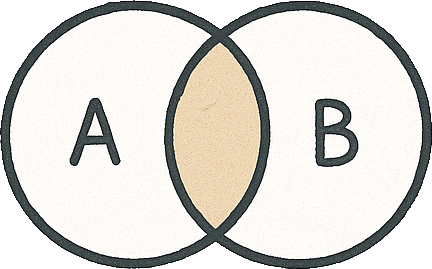
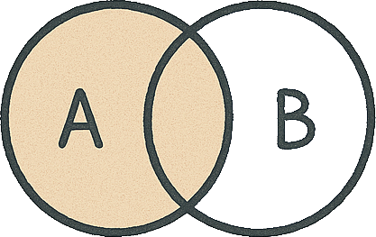
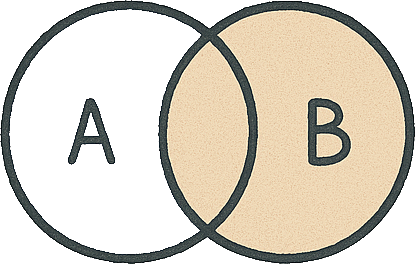
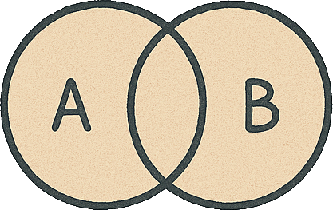

# Jointures

Les opérations de jointures sont réalisées en créant une *table virtuelle* issue du [produit cartésien][1] de **deux tables**, qui sera par la suite **filtrée** selon le **type de jointure souhaitée** parmi celles présentées ci dessous :

Les tables de données ci dessous sont utilisées dans les différents exemples :

```sql
DECLARE @users TABLE (
	Name NVARCHAR(50), 
	GroupId INT)
DECLARE @groups TABLE (
    Id INT,
    Name NVARCHAR(50),
    ParentGroupId INT NULL
)

INSERT INTO @users (Name, GroupId) VALUES
	('John', 1),
	('Alice', 2),
	('Clark', NULL)
INSERT INTO @groups (Id, Name, ParentGroupId) VALUES
(1, 'Administrator', NULL),
(2, 'Moderator', 1),
(3, 'Contributor', 2)
```

## Interne

Conserve les **utilisateurs** appartenant à un **groupe**



```sql
-- Syntaxe ANSI SQL-89 
SELECT u.Name AS 'User', g.Name AS 'Group'
FROM @users AS u, @groups AS g
WHERE g.id = u.GroupId

-- Syntaxe ANSI SQL-92
SELECT u.Name AS 'User', g.Name AS 'Group'
FROM @users AS u
INNER JOIN @groups AS g ON g.id = u.GroupId
```

> [!note]
> Le mot clé `INNER` qui précède `JOIN` peut être omis bien qu'il soit **recommandé**

| User  | Group         |
| ----  | ------------- |
| John  | Administrator |
| Alice | Moderator     |

## Externe

> [!note]
> Le mot clé `OUTER` entre `LEFT|RIGHT|FULL` et `JOIN` peut être omis bien qu'il soit **recommandé**

### Gauche

Conserve tous les **utilisateurs** avec les **groupes** associés ou `NULL` pour ceux qui n'en ont pas



```sql
SELECT u.Name AS 'User', g.Name AS 'Group'
FROM @users AS u
LEFT OUTER JOIN @groups AS g ON g.Id = u.GroupId
```

| User  | Group         |
| ----  | ------------- |
| John  | Administrator |
| Alice | Moderator     |
| Clark | *NULL*        |


### Droite
Conserve toutes les **groupes** avec leur **utilisateurs** ou `NULL` pour ceux qui n'en ont pas



```sql
SELECT u.Name AS 'User', g.Name AS 'Group'
FROM @users AS u
RIGHT OUTER JOIN @groups AS g ON g.Id = u.GroupId
```

| User   | Group         |
| ----   | ------------- |
| John   | Administrator |
| Alice  | Moderator     |
| *NULL* | Contributor   |

### Complète
Conserve à la fois :
- tous les **utilisateurs** avec leur **groupe** ou `NULL` pour celles qui n'en ont pas
- tous les **groupes** avec les **utilisateurs** associés ou `NULL` pour ceux qui n'en ont pas



```sql
SELECT u.Name AS 'User', g.Name AS 'Group'
FROM @users AS u
FULL OUTER JOIN @groups AS g ON g.Id = u.GroupId
```

| User   | Group         |
| ----   | ------------- |
| John   | Administrator |
| Alice  | Moderator     |
| Clark  | *NULL*        |
| *NULL* | Contributor   |

## Croisée

Conserve tous les résultats en n'appliquant aucun filtre

```sql
SELECT g.Name AS 'GroupName', lc.MerchantName
FROM [dbo].[Group] AS g
CROSS JOIN [dbo].[LoyaltyCard] AS lc
```

## Réflexive

Conserve tous les **groupes** avec leur **groupe enfant** ou `NULL` pour ceux qui n'en ont pas

```sql
SELECT parentGroup.Name AS 'ParentGroupName', childGroup.Name AS 'ChildGroupName' 
FROM @groups AS parentGroup
LEFT OUTER JOIN @groups AS childGroup ON parentGroup.Id = childGroup.ParentGroupId
```

> [!Note] 
> Le produit cartésien est appliqué à partir de deux instances d'une seule et même table.

| ParentGroupName | ChildGroupName |
| --------------- | -------------- |
| Administrator   | Moderator      |
| Moderator       | Contributor    |
| Contributor     | *NULL*         |

[1]: https://fr.wikipedia.org/wiki/Produit_cart%C3%A9sien
