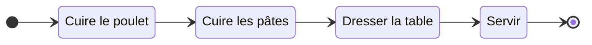
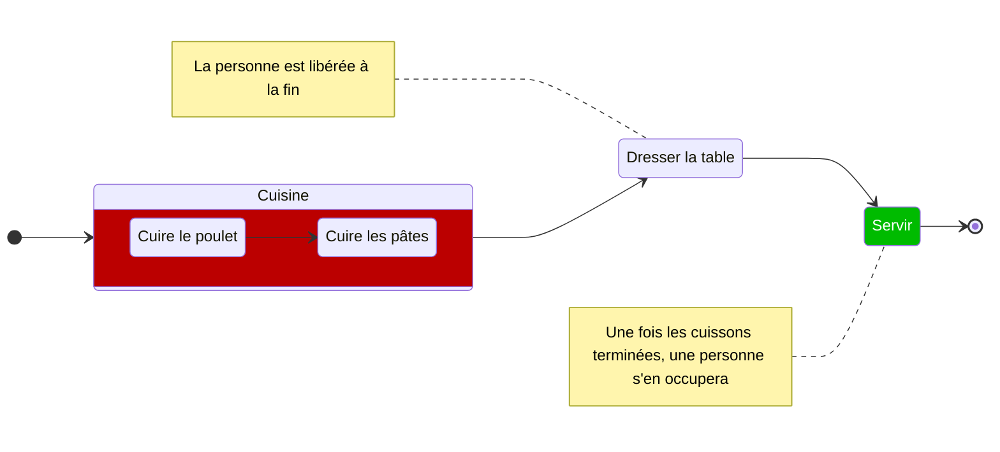
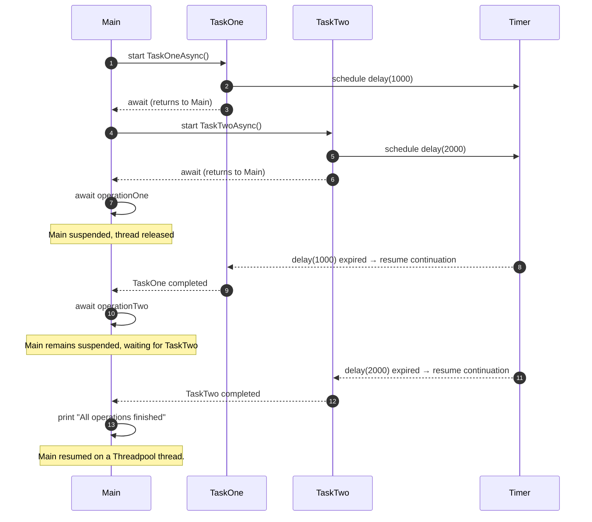

# Asynchronisme

## Présentation

L’asynchronisme consiste à exécuter une tâche en arrière-plan tout en poursuivant le traitement principal, puis à récupérer le résultat une fois la tâche terminée.

Prenons comme analogie la préparation d’un déjeuner à la maison, où :
- Une **personne** représente un [```Thread```][Thread].
- Une **opération rouge** représente un groupe de [```Task```][Task].
- Une **opération verte** ne peut être exécutée qu'une fois les [```Task```][Task] nécessaires terminées.

### Exécution synchrone

La personne est sollicitée durant toute la préparation et attend devant la plaque chauffante pour chaque cuisson.



### Exécution asynchrone

La personne programme les cuissons sur les plaques chauffantes, dresse la table, puis est libérée. Lorsque le minuteur signalera la fin des cuissons, elle ou une autre personne se chargera du service.



> [!NOTE]
> Dans les bibliothèques .NET, la plupart des opérations asynchrones (requêtes TCP/IP, système de fichiers, compte à rebours...) sont déléguées à des composants du système d'exploitation (comme [IOCP] sous Windows). Un peu de la même manière qu'une *cuisson* est réalisée par une *plaque chauffante* qui est un composant d'une *cuisine*. 
> 
> Une fois complétées, elles envoient un signal au **runtime**, qui demande au [```ThreadPool```][ThreadPool] un [```Thread```][Thread] disponible afin de poursuivre l’exécution du programme.


## Implémentation

La version 5 de C# a introduit une approche simplifiée pour rendre des méthodes asynchrones : 
1. Sa **signature** doit comprendre le modificateur [```async```][async], indiquant qu'une méthode ou expression lambda est asynchrone.
2. Son **nom** doit comprendre le suffixe *Async*.
3. Le **type de retour** doit être au choix :
    - [```Task```][Task] : une opération asynchrone.
    - [```Task<TResult>```][Task<TResult>] : une opération asynchrone qui produit un résultat.
4. Elle doit comporter au moins une expression [```await```][await], qui 
   1. Attend le retour de la tâche de la méthode asynchrone associée.
   2. Rend la main au code appelant.

> [!NOTE]
> - Un [```Thread```][Thread] est un fil d’exécution d'instructions auquel le système d'exploitation alloue du temps processeur.
> - Le [```ThreadPool```][ThreadPool] est un ensemble de [```Thread```][Thread] gérés et réservés par le runtime .NET.
> - Une [```Task```][Task] (on parle aussi de [future]) s’exécute sur un [```Thread```][Thread] disponible dans le [```ThreadPool```][ThreadPool].

## Exemple

```csharp
using System.Diagnostics;

async Task TaskOneAsync()
{
    WriteLine(nameof(TaskOneAsync), "started");
    await Task.Delay(1000);
    WriteLine(nameof(TaskOneAsync), "ended");
}

async Task TaskTwoAsync()
{
    WriteLine(nameof(TaskTwoAsync), "started");
    await Task.Delay(2000);
    WriteLine(nameof(TaskTwoAsync), "ended");
}

void WriteLine(string name, string state)
{
    Console.WriteLine($"{name} {state} on thread {Environment.CurrentManagedThreadId}");
}

WriteLine("Main", "started");
Stopwatch sw = new();
sw.Start();

Task operationOne = TaskOneAsync();
Task operationTwo = TaskTwoAsync();

// await Task.WaitAll(operationOne, operationTwo)
await operationOne;
await operationTwo;

sw.Stop();
WriteLine("Main", $"ended in {sw.ElapsedMilliseconds} ms");
```

```console
Main started on thread 1
TaskOneAsync started on thread 1
TaskTwoAsync started on thread 1
TaskOneAsync ended on thread 5
TaskTwoAsync ended on thread 5
Main ended in 2023ms on thread 5
```



[Task]: https://learn.microsoft.com/en-us/dotnet/api/system.threading.tasks.task
[Task<TResult>]: https://learn.microsoft.com/en-us/dotnet/api/system.threading.tasks.task-1
[ThreadPool]: https://learn.microsoft.com/en-us/dotnet/api/system.threading.threadpool
[Thread]: https://learn.microsoft.com/en-us/dotnet/api/system.threading.thread
[future]: https://fr.wikipedia.org/wiki/Futures_(informatique)
[async]: https://learn.microsoft.com/en-us/dotnet/csharp/language-reference/keywords/async
[await]: https://learn.microsoft.com/en-us/dotnet/csharp/language-reference/operators/await
[IOCP]: https://learn.microsoft.com/en-us/windows/win32/fileio/i-o-completion-ports