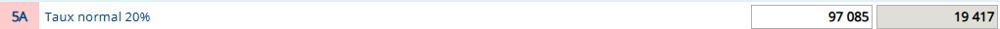
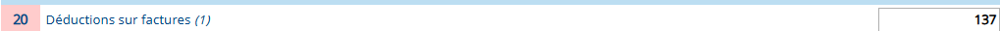
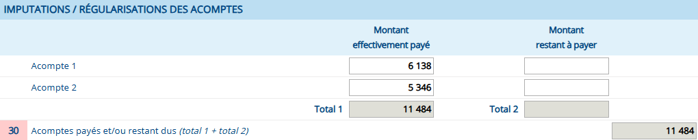
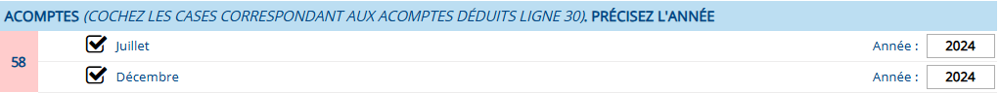
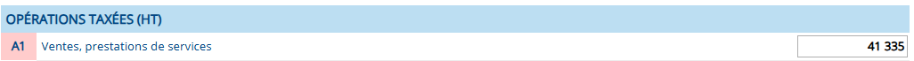
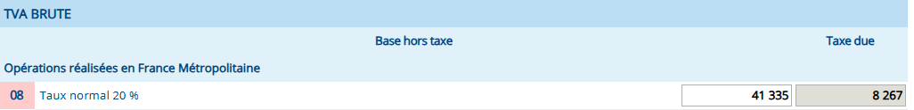
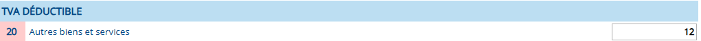

# TVA

Pour le remplissage de ces formulaires, nous tiendrons compte du profil suivant :
- Travailleur effectuant des prestations de services
- Activité professionnelle réalisée en France

## Régime simplifié d'imposition

> [!warning] Attention
> Ce régime est accessible au entreprise déclarant moins de 15000 euros de TVA sur le **formulaire CA12**

### Formulaire CA12 (3517–S)

1. Le chiffre réalisée l'année dernière

1. Montant total de la TVA payées sur les **dépenses professionnelles**

1. Les montants des deux acomptes payées l'année dernière (dans le cas d'acomptes semestriels)

1. Les années de paiements de ces acomptes

## Régime miniréel

### Formulaire 3310–CA3

1. Le chiffre d'affaire réalisé le mois dernier

2. Chiffre d'affaire pour les prestations réalisées avec un taux de 20% de TVA collectée

3. Montant total de la TVA payées sur les **dépenses professionnelles**

